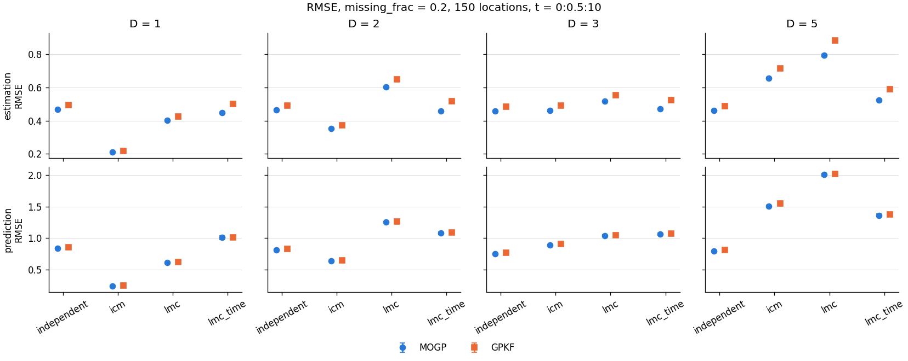
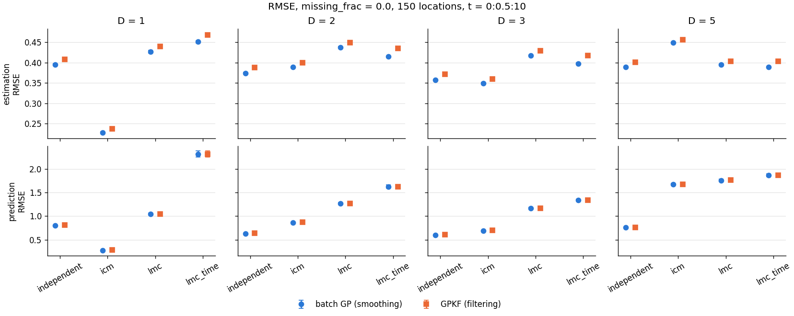
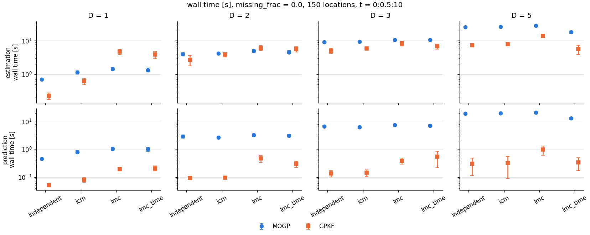
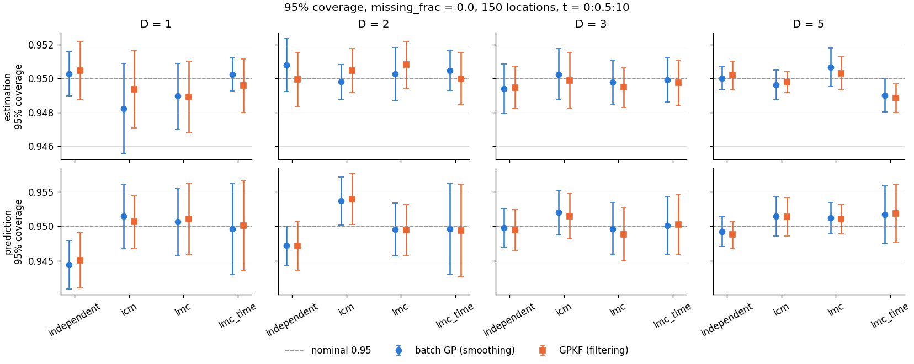
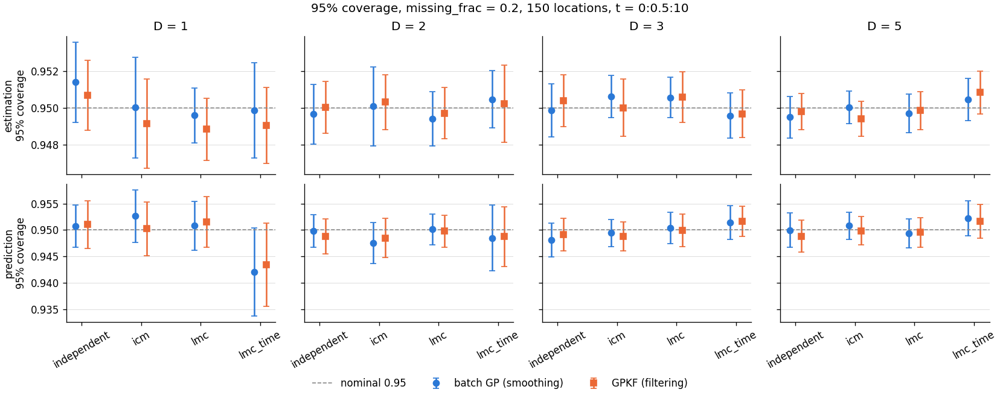
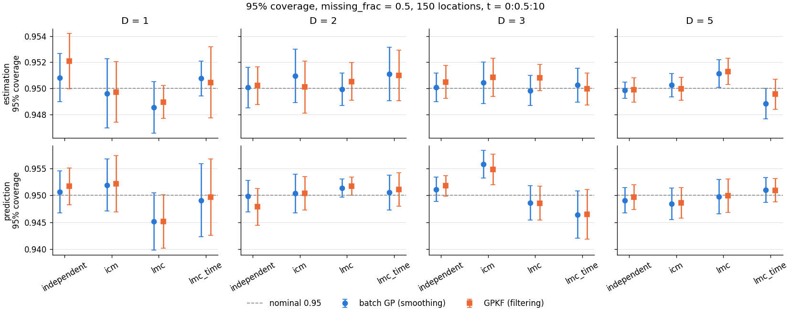

## Outline {.smaller}



1. Background: Gaussian processes & Kalman filtering
2. The GPKF approach of @Todescato-Efficient-2020
3. Extension to multi-output responses
4. Simulation study
5. Discussion & future work

::: {.notes}
Speaker notes go here — press **S** during the talk to open the speaker view.
:::

# Background {background-color="#1E3765"}

## A plain slide

- Bullet points appear all at once by default
- Use `. . .` on its own line to pause

. . .

- ...like this one, which appears on the next click

::: {.fragment .highlight-blue}
A fragment that changes colour when it appears.
:::

## Math {.smaller}

A latent Gaussian process with i.i.d. noise:

$$
y_i = f(\bfx_i, t_i) + \varepsilon_i,
\qquad f \sim \calGP\big(0, k(\cdot, \cdot)\big),
\qquad \varepsilon_i \simiid \calN(0, \sigma^2).
$$

Posterior mean and variance at a new input $\bfx_*$:

$$
\begin{aligned}
\expec{f_* \mid \bfy} &= \tpose{\bfk_*} \left(\bfK + \sigma^2 \bfI\right)^{-1} \bfy, \\
\var{f_* \mid \bfy}   &= k_{**} - \tpose{\bfk_*} \left(\bfK + \sigma^2 \bfI\right)^{-1} \bfk_*.
\end{aligned}
$$

::: {.callout-note}
## Cost
Naïve inference is $\calO(n^3)$ in the number of observations $n$.
:::

## Definitions, theorems & callouts

::: {.callout-tip icon=false}
## Definition (State-space model)
$\bfz_{k+1} = \bfA \bfz_k + \bfw_k$, $\quad y_k = \bfC \bfz_k + v_k$.
:::

::: {.callout-important icon=false}
## Theorem
Statement of a key result. Cite sources inline like this [@GPML-Book-2006].
:::

::: {.callout-warning}
Callouts come in `note`, `tip`, `important`, `warning` and `caution`.
:::

# Methods {background-color="#1E3765"}

## Two columns

:::: {.columns}

::: {.column width="50%"}
**Left column**

- Text, lists or equations
- $\bfSigma = \bfK \otimes \bfB$
:::

::: {.column width="50%"}
**Right column**

```python
import numpy as np

def rbf(x, y, ell=1.0):
    return np.exp(-0.5 * (x - y)**2 / ell**2)
```
:::

::::

## Algorithm {.smaller}

::: {.algorithm}
**Algorithm 1:** Kalman filter (one step)

1. **Predict:** $\hat{\bfz}_{k \mid k-1} = \bfA \hat{\bfz}_{k-1}$, $\quad \bfP_{k \mid k-1} = \bfA \bfP_{k-1} \tpose{\bfA} + \bfQ$
2. **Gain:** $\bfG_k = \bfP_{k \mid k-1} \tpose{\bfC} \left(\bfC \bfP_{k \mid k-1} \tpose{\bfC} + \bfR\right)^{-1}$
3. **Update:** $\hat{\bfz}_k = \hat{\bfz}_{k \mid k-1} + \bfG_k \left(\bfy_k - \bfC \hat{\bfz}_{k \mid k-1}\right)$
:::

# Results {background-color="#1E3765"}

## A single figure

{fig-align="center" height="520"}

## Side-by-side figures

::: {layout-ncol=2}



:::

## Tabsets {.smaller}

::: {.panel-tabset}

### 0% missing
{fig-align="center" height="440"}

### 20% missing
{fig-align="center" height="440"}

### 50% missing
{fig-align="center" height="440"}

:::

## Table {.smaller}

| Method       | RMSE  | MAE   | Coverage | Time (s) |
|:-------------|------:|------:|---------:|---------:|
| Full GP      | 0.000 | 0.000 |    0.00  |     0.00 |
| GPKF         | 0.000 | 0.000 |    0.00  |     0.00 |
| Multi-output | 0.000 | 0.000 |    0.00  |     0.00 |

: Placeholder results — fill in from `Code/results/full/simulation_results.csv`. {tbl-colwidths="[40,15,15,15,15]"}

# Conclusion {background-color="#1E3765"}

## Summary

::: {.incremental}
- First takeaway
- Second takeaway
- Third takeaway
:::

## Thank you! {.center}

Questions?

[joey.hotz@mail.utoronto.ca](mailto:joey.hotz@mail.utoronto.ca)

## References {.smaller .scrollable}

::: {#refs}
:::

# Appendix {.unnumbered .unlisted background-color="#1E3765"}

## Backup slide {visibility="uncounted"}

Extra material for questions — not counted in the slide total.
